# A0-M1-U1-L01

> A0 · M1 · U1 · 1/6

## 1. 0 →

**0 →**

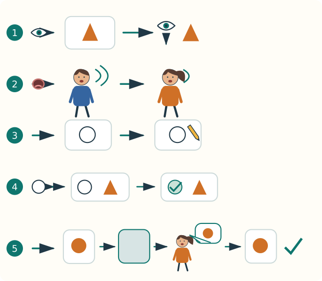

 → 

 → 

 → ✓ / ✗

## 2. → ✓

| | → |
|---|---|
| 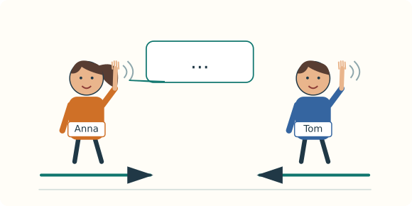 |  |
| 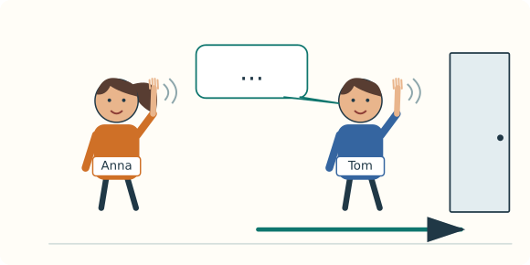 |  |
| 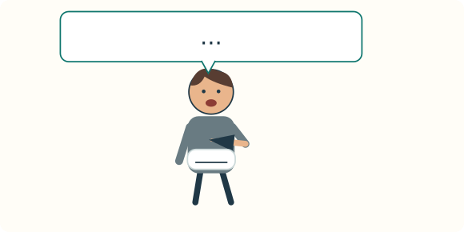 |   |

## 3. 0

**0**

## 4. →

<!-- teach: V0001 V0003 -->

### 4.1. P1

**hello! → hi!**

 hello! → hello! → hello!

 hi! → hi! → hi!

<!-- teach: V0002 V0004 -->

### 4.2. P2

**goodbye! → bye!**

 goodbye! → goodbye! → goodbye!

 bye! → bye! → bye!

<!-- teach: V0007 V0009 -->

### 4.3. P3

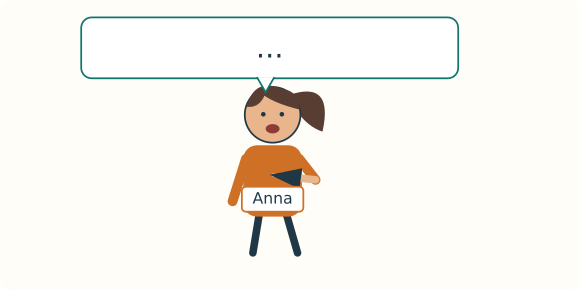

**I → I am Anna.**

 I am Anna. → I am Anna. → I am Anna.

**I + am → I am Anna.**

<!-- teach: V0008 V0010 -->

### 4.4. P4

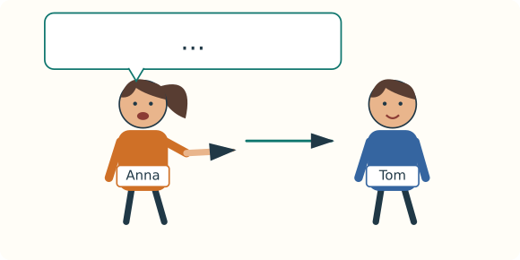

**you → You are Tom.**

 You are Tom. → You are Tom. → You are Tom.

**you + are → You are Tom.**

## 5. I · you

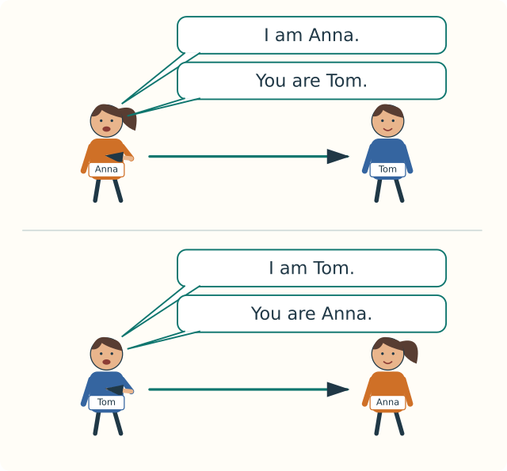

## 6. I → am · you → are

| | ✓ | ✗ |
|---|---|---|
|  | **I am Anna.** | I are Anna. |
|  | **You are Tom.** | You am Tom. |
| 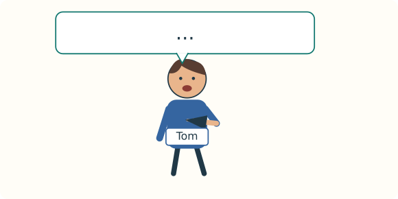 | **I am Tom.** | I are Tom. |
| 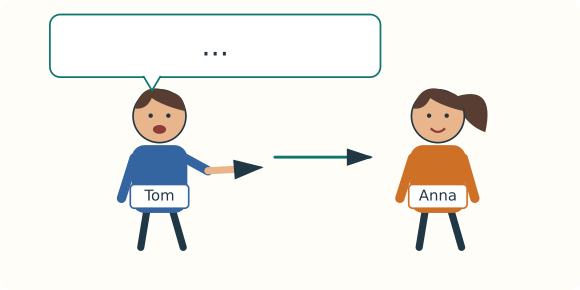 | **You are Anna.** | You am Anna. |

**I → am**

**you → are**

**hello → hi**

**goodbye → bye**

## 7. E01 → E07

| | | |
|---|---|---|
| E01 | P1 | Hello! |
| E02 | P2 | Goodbye! |
| E03 |  | I am Anna. |
| E04 |  | I am Tom. |
| E05 |  | You are Tom. |
| E06 |  | You are Anna. |

### E07

**P1 → P2**

| | |
|---|---|
| Anna | Hello! I am Anna. |
| Tom | Hi! I am Tom. |
| Anna → Tom | You are Tom. |
| Tom → Anna | You are Anna. |
| Anna | Goodbye, Tom! |
| Tom | Bye, Anna! |

## 8. 

**hi → I → hi → I**

**bye → I → bye → I**

**I am Anna. → You are Tom.**

**Hello! I am Anna. → Hi! I am Tom.**

## 9. 

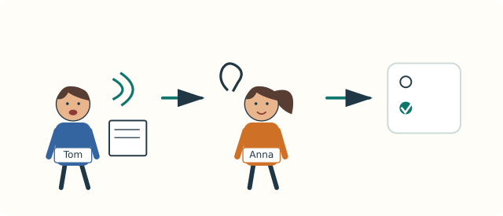

 → 

**P1:** 

**P2:** 

| | | |
|---|---|---|
| L01 | 1 → ___ | P1 / P2 |
| L02 | 2 → ___ | P1 / P2 |
| L03 | 3 → ___ | I am Anna. / You are Anna. |
| L04 | 4 → ___ | I am Tom. / You are Tom. |

SCRIPT ONLY — no audio recording

1. Hello!
2. Goodbye!
3. I am Anna.
4. You are Tom.

## 10. 

<!-- reading:start -->
Anna: Hello! I am Anna.

Tom: Hi! I am Tom.

Anna: Goodbye, Tom!

Tom: Bye, Anna!
<!-- reading:end -->

**P1 → P2**

| | | |
|---|---|---|
| R01 | ___ | P1 → P2 / P2 → P1 |
| R02 | I ___ Anna. | am / are |
| R03 | Anna → Tom: You ___ Tom. | am / are |
| R04 | Goodbye, Tom! → ___, Anna! | Hi / Bye |

## 11. 

**P3: I ___ Anna. → I am Anna. ✓**

| | | |
|---|---|---|
| A01 |  ___! | hello / goodbye |
| A02 |  ___! | hi / bye |
| A03 | hello → ___ | hi / bye |
| A04 | goodbye → ___ | hi / bye |
| A05 | I ___ Anna. | am / are |
| A06 | You ___ Tom. | am / are |
| A07 | ___ am Tom. | I / you |
| A08 | ___ are Anna. | I / You |

## 12. 

**P1 → Hello! / Hi! ✓**

| | | |
|---|---|---|
| B01 |  | ___! |
| B02 |  | ___, Tom! |
| B03 |  | I am ___. |
| B04 |  | You ___ Tom. |

## 13. 

**E07 → Anna → Tom → Anna → Tom**

| | | |
|---|---|---|
| S01 |  E07 | Hello! I am Anna. → Hi! I am Tom. → You are Tom. → You are Anna. → Goodbye, Tom! → Bye, Anna! |
| S02 |  P1 → P2 | ___! I am ___. → ___! |

**✓ I am ___. · ✓ You are Tom. · ✓ Hello! / Hi! · ✓ Goodbye! / Bye!**

## 14. 

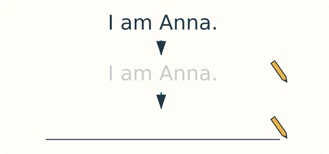

| | | |
|---|---|---|
| W01 | I am Anna. → | ____________________ |
| W02 |  I am ___. → | ____________________ |
| W03 |  You are Tom. → | ____________________ |

**I → am · you → are**

## 15. 

| | | |
|---|---|---|
| T01 |  |  ___! |
| T02 |  |  ___! |
| T03 |  |  ___ |
| T04 |  |  ___ |
| T05 |  |  ___ |
| T06 | I ___ Anna. · You ___ Tom. |  ___ · ___ |

## 16. ✗ → ✓

**✗ I are Anna. → ✓ I am Anna.**

**✗ You am Tom. → ✓ You are Tom.**

**✗ I Anna. → ✓ I am Anna.**

## 17. A0-M1-U1-L01-QZ

**8 × 1 → 8**

| | | |
|---|---|---|
| Q01 |  ___! | hello / goodbye |
| Q02 |  ___! | hi / bye |
| Q03 | I ___ Anna. | am / are |
| Q04 | You ___ Tom. | am / are |
| Q05 | ___ am Tom. | I / you |
| Q06 | ___ are Anna. | I / You |
| Q07 |  I ___ ___. |  ___ |
| Q08 |  You ___ Tom. → |  ___ |

**6/8 · 7/8 · 8/8 → ✓**

**0–5/8 → §4 + §6 + §11 + §12**

**Q07:  → ✓ / ✗ / ? · ? → ?/8**

## 18. ✓

✓

| | ✓ |
|---|---|
| L01 | P1 |
| L02 | P2 |
| L03 | I am Anna. |
| L04 | You are Tom. |
| R01 | P1 → P2 |
| R02 | am |
| R03 | are |
| R04 | Bye |
| A01 | hello |
| A02 | bye |
| A03 | hi |
| A04 | bye |
| A05 | am |
| A06 | are |
| A07 | I |
| A08 | You |
| B01 | Hello! / Hi! |
| B02 | Goodbye, Tom! / Bye, Tom! / Goodbye! / Bye! |
| B03 | I am ___. → I am Anna. / I am Tom. |
| B04 | You are Tom. |
| S01 | Hello! I am Anna. → Hi! I am Tom. → You are Tom. → You are Anna. → Goodbye, Tom! → Bye, Anna! |
| S02 | Hello! I am ___. → Goodbye! / Hi! I am ___. → Bye! |
| W01 | I am Anna. |
| W02 | I am ___. → I am Anna. / I am Tom. |
| W03 | You are Tom. |
| T01 | Hello! / Hi! |
| T02 | Goodbye! / Bye! |
| T03 | I am Anna. |
| T04 | You are Tom. |
| T05 | I am ___. → I am Anna. / I am Tom. |
| T06 | am · are |
| Q01 | hello |
| Q02 | bye |
| Q03 | am |
| Q04 | are |
| Q05 | I |
| Q06 | You |
| Q07 | I am ___. → I am Anna. / I am Tom. |
| Q08 | You are Tom. |

**P1 → hello / hi · P2 → goodbye / bye**

**I → am · you → are**

**___ →** 

**Q01–Q06: ✓ = 1 · ✗ = 0**

**Q07: ✓ I am ___. = 1 · ✗ I are ___. = 0**

**Q08: ✓ You are Tom. = 1 · ✗ You am Tom. = 0**

## 19. +1 → +3 → +7 → +21 → +60

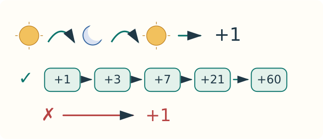

| | | |
|---|---|---|
| → L02 §1 | T01 + T02 + T03 + T04 + T06 |   |
| +1 | T02 → T01 → T04 → T03 |  |
| +3 | W02 + W03 |  |
| +7 | T06 + T04 + T03 + T01 + T02 |   |
| +21 | S02 + T04 |  |
| +60 | S02 + W02 + W03 |   |

**✗ → +1 · §4 + §6 + §11 + §12**

## 20. ✓ / ?

- [ ]  Hello! / Hi!
- [ ]  Goodbye! / Bye!
- [ ]  I am ___.
- [ ]  You are Tom.
- [ ] Q01–Q08: 6/8 · 7/8 · 8/8
- [ ] +7 ✓ · +21 ✓ · +60 ✓

## 21. —

<!--
NEW_VOCAB: V0001, V0003, V0002, V0004, V0007, V0009, V0008, V0010
NEW_GRAMMAR: G003, G004
REVIEWED_VOCAB: none
REVIEWED_GRAMMAR: none
LESSON_TITLE: Hello and Goodbye — First Words and Sounds
ESTIMATED_TIME_MIN: 50-70, untrialled; sound work needs a competent helper.
INCIDENTAL: Anna and Tom are picture-locked identity labels, never vocabulary or spelling targets. Numerals and task IDs are demonstrated navigation symbols. All headings use symbols or already-taught words and are inventory-checked. Optional IPA and the SCRIPT ONLY delivery notice are helper reference; the machine footer is hidden metadata. No instruction verb is required. Actual action demonstrations precede all tasks. No contractions, negatives, questions, alphabet knowledge or object nouns are assumed. Listening requires a competent helper; there is no recorded audio.
-->
