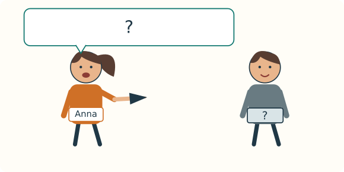
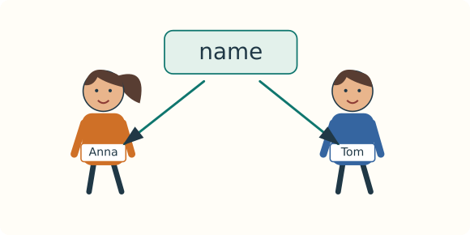
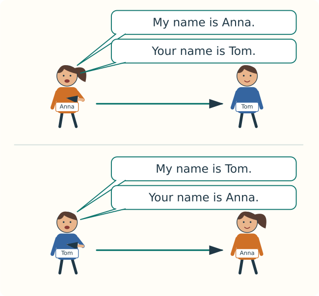
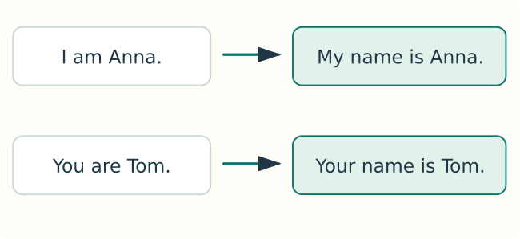
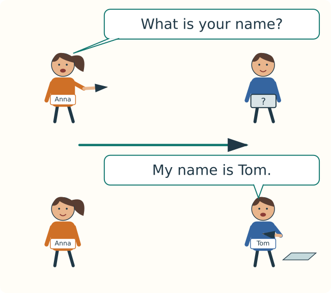
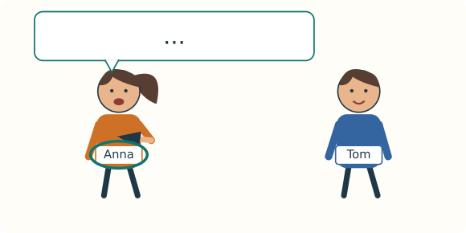
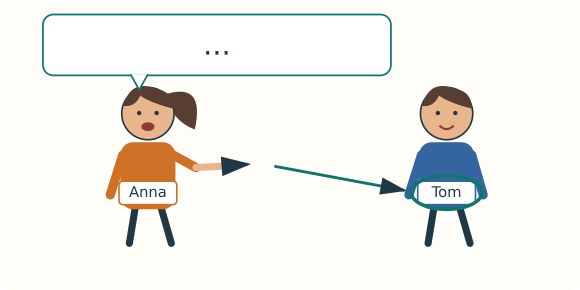
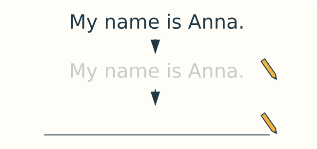

# A0-M1-U1-L02

> A0 · M1 · U1 · 2/6

## 1. 

| | | |
|---|---|---|
| H01 |  ___! | hello / goodbye |
| H02 |  ___! | hi / bye |
| H03 |  ___! | goodbye / hello |
| H04 |  ___! | bye / hi |
| H05 |  |  ___ |
| H06 |  |  ___ |

**✗ → L01 §4 + §6**

## 2. → ✓

| | → |
|---|---|
|  |   |
|  |  |
|  |  |

## 3. I am · You are

**hello · hi · goodbye · bye · I · you · am · are**

**I am Anna. · You are Tom.**

## 4. →

<!-- teach: V0013 -->

### 4.1. name

**name → Anna · Tom**

 name → name → name

<!-- teach: V0011 V0012 V0015 -->

### 4.2. my · your · is

**my name → My name is Anna.**

**your name → Your name is Tom.**

**My name + is + Anna → My name is Anna.**

**Your name + is + Tom → Your name is Tom.**

 My name is Anna. → Your name is Tom.

 My name is Tom. → Your name is Anna.

<!-- teach: V0014 -->

### 4.3. what → What is your name?

**? → What is your name?**

**What is your name? → My name is Tom.**

 What is your name? → What is your name? → What is your name?

## 5. ?

| | |
|---|---|
| Anna | Hello! What is your name? |
| Tom | Hi! My name is Tom. |

## 6. my name · your name

| | ✓ |
|---|---|
|  | **My name is Anna.** |
|  | **Your name is Tom.** |
|  | **What is your name?** |

**I am Anna. → My name is Anna.**

**You are Tom. → Your name is Tom.**

**my + name · your + name**

**My name → is · Your name → is**

**What + is + your + name + ? → What is your name?**

**What is your name? → My name is Anna. / I am Anna.**

## 7. E01 → E07

| | | |
|---|---|---|
| E01 |  | My name is Anna. |
| E02 |  | My name is Tom. |
| E03 |  | Your name is Tom. |
| E04 |  | Your name is Anna. |
| E05 |  | What is your name? → My name is Tom. |
| E06 |  | My name is ___. → I am ___. |

### E07

**P1 → ? → P2**

| | |
|---|---|
| Anna | Hello! What is your name? |
| Tom | Hi! My name is Tom. What is your name? |
| Anna | My name is Anna. |
| Tom → Anna | Your name is Anna. |
| Anna → Tom | Your name is Tom. |
| Anna | Goodbye, Tom! |
| Tom | Bye, Anna! |

## 8. 

**I → my → I → my**

**name → My name → My name is Anna.**

**name → your name → What is your name?**

**My name is Anna. → Your name is Tom.**

**What is your NAME? ↓**

## 9. 

 → 

| | | |
|---|---|---|
| L01 | 1 → ___ name is Anna. | My / Your |
| L02 | 2 → ___ name is Tom. | My / Your |
| L03 | 3 → ___ | What is your name? / My name is Anna. |
| L04 | 4 → ___ | My name is Tom. / My name is Anna. |

SCRIPT ONLY — no audio recording

1. My name is Anna.
2. Your name is Tom.
3. What is your name?
4. Hello! My name is Tom.

## 10. 

<!-- reading:start -->
Anna: Hello! My name is Anna.

Tom: Hi! I am Tom.

Anna: What is your name?

Tom: My name is Tom.

Tom → Anna: Your name is Anna.

Anna: Goodbye, Tom!

Tom: Bye, Anna!
<!-- reading:end -->

| | | |
|---|---|---|
| R01 | ___ | P1 → P2 / P2 → P1 |
| R02 | My name ___ Tom. | is / are |
| R03 | ? → ___ | What is your name? / Your name is Tom. |
| R04 | Tom → Anna: ___ name is Anna. | My / Your |

## 11. 

**My name ___ Anna. → My name is Anna. ✓**

| | | |
|---|---|---|
| A01 | My ___ is Anna. | name / am |
| A02 | My name ___ Tom. | is / are |
| A03 | Your name ___ Anna. | am / is |
| A04 | ___ is your name? | What / My |
| A05 | What ___ your name? | is / are |
| A06 | What is ___ name? | your / you |
| A07 |  ___ name is Anna. | My / Your |
| A08 |  ___ name is Tom. | My / Your |

## 12. 

**? → What is your name? → My name is Anna.**

| | | |
|---|---|---|
| B01 |  | My name is ___. |
| B02 |  | Your name is ___. |
| B03 |  | ___? |
| B04 | What is your name?  | ___ |

## 13. 

**E07 → Anna → Tom → Anna → Tom**

| | | |
|---|---|---|
| S01 | E07  | What is your name? → My name is Tom. → What is your name? → My name is Anna. → Your name is Anna. → Your name is Tom. |
| S02 |  | What is your name? → My name is ___. |

**✓ My name is ___. · ✓ Your name is Tom. · ✓ What is your name?**

## 14. 

| | | |
|---|---|---|
| W01 | My name is Anna. → | ____________________ |
| W02 |  My name is ___. → | ____________________ |
| W03 |  Your name is Tom. → | ____________________ |
| W04 | What is your name? → | ____________________ |

**my + name · your + name · name → is**

## 15. 

| | | |
|---|---|---|
| T01 |  |  ___! |
| T02 |  My ___ |  ___ |
| T03 |  |  ___ |
| T04 |  |  ___ |
| T05 | My name ___ Anna. |  ___ |
| T06 | What ___ your name? |  ___ |
| T07 |  |  ___! |

## 16. ✗ → ✓

**✗ My name Anna. → ✓ My name is Anna.**

**✗ Your name are Tom. → ✓ Your name is Tom.**

**✗ What your name is? → ✓ What is your name?**

**✗ You name is Tom. → ✓ Your name is Tom.**

## 17. A0-M1-U1-L02-QZ

**8 × 1 → 8**

| | | |
|---|---|---|
| Q01 |  ___ name is Anna. | My / Your |
| Q02 |  ___ name is Tom. | My / Your |
| Q03 | My name ___ Anna. | am / is |
| Q04 | Your ___ is Tom. | name / are |
| Q05 | What ___ your name? | is / are |
| Q06 | What is ___ name? | you / your |
| Q07 |  |  ___ |
| Q08 |  My name ___ ___. |  ___ |

**6/8 · 7/8 · 8/8 → ✓**

**0–5/8 → §4 + §6 + §11 + §12**

**Q07:  → ✓ / ✗ / ? · ? → ?/8**

## 18. ✓

✓

| | ✓ |
|---|---|
| H01 | hello |
| H02 | hi |
| H03 | goodbye |
| H04 | bye |
| H05 | I am Anna. |
| H06 | You are Tom. |
| L01 | My |
| L02 | Your |
| L03 | What is your name? |
| L04 | My name is Tom. |
| R01 | P1 → P2 |
| R02 | is |
| R03 | What is your name? |
| R04 | Your |
| A01 | name |
| A02 | is |
| A03 | is |
| A04 | What |
| A05 | is |
| A06 | your |
| A07 | My |
| A08 | Your |
| B01 | My name is ___. → My name is Anna. / My name is Tom. |
| B02 | Your name is Tom. |
| B03 | What is your name? |
| B04 | My name is ___. / I am ___. / ___. → My name is Anna. / I am Anna. / Anna. / Tom. |
| S01 | What is your name? → My name is Tom. → What is your name? → My name is Anna. → Your name is Anna. → Your name is Tom. |
| S02 | What is your name? → My name is ___. |
| W01 | My name is Anna. |
| W02 | My name is ___. → My name is Anna. / My name is Tom. |
| W03 | Your name is Tom. |
| W04 | What is your name? |
| T01 | Hello! / Hi! |
| T02 | My name is ___. → My name is Anna. / My name is Tom. |
| T03 | What is your name? |
| T04 | Your name is Tom. |
| T05 | is |
| T06 | is |
| T07 | Goodbye! / Bye! |
| Q01 | My |
| Q02 | Your |
| Q03 | is |
| Q04 | name |
| Q05 | is |
| Q06 | your |
| Q07 | What is your name? |
| Q08 | My name is ___. → My name is Anna. / My name is Tom. |

**my →** 

**your →** 

**My name → is · Your name → is**

**? → What is your name?**

**___ →** 

**Q01–Q06: ✓ = 1 · ✗ = 0**

**Q07: ✓ What is your name? = 1 · ✗ What your name is? = 0**

**Q08: ✓ My name is ___. = 1 · ✗ My name ___. = 0**

## 19. +1 → +3 → +7 → +21 → +60

| | | |
|---|---|---|
| → L03 §1 | T01 + T02 + T03 + T04 + T07 |  |
| +1 | T07 → T03 → T02 → T04 → T01 |  |
| +3 | W02 + W03 + W04 |  |
| +7 | T05 + T06 + T03 + T04 + T02 |   |
| +21 | S02 + T01 + T07 |  |
| +60 | S02 + W02 + W03 + W04 |   |

**✗ → +1 · §4 + §6 + §11 + §12**

## 20. ✓ / ?

- [ ]  My name is ___.
- [ ]  Your name is Tom.
- [ ]  What is your name?
- [ ]  My name is ___.
- [ ] Q01–Q08: 6/8 · 7/8 · 8/8
- [ ] +7 ✓ · +21 ✓ · +60 ✓

## 21. —

<!--
NEW_VOCAB: V0013, V0011, V0012, V0015, V0014
NEW_GRAMMAR: G011, G010
REVIEWED_VOCAB: V0001, V0003, V0002, V0004, V0007, V0009, V0008, V0010
REVIEWED_GRAMMAR: G003, G004
LESSON_TITLE: Hello and Goodbye — Grammar Foundations
ESTIMATED_TIME_MIN: 50-70, untrialled; sound work needs a competent helper.
INCIDENTAL: Anna and Tom are picture-locked name labels, not vocabulary or spelling targets. Numerals and task IDs are demonstrated navigation symbols. All headings use symbols or already-taught words and are inventory-checked. Optional IPA and the SCRIPT ONLY delivery notice are helper reference; the machine footer is hidden metadata. The main new frame is My/Your name is. What is your name? is an explicitly taught whole-chunk preview of G010, not permission to generate other wh-questions. Is is taught only after name and in this question. No object nouns, alphabet knowledge, negative forms, yes/no questions, he/she, his/her or generic imperatives are assumed. There is no recorded audio.
-->
